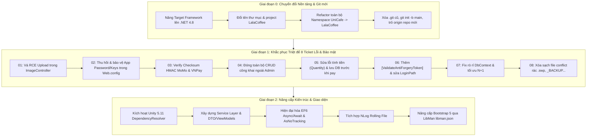

# Bản Đặc Tả: Nâng Cấp Dự Án LalaCoffee & Khắc Phục Lỗi (Master Plan)

## 1. Mục tiêu tổng thể
Chuyển đổi toàn diện dự án từ **UniCafe** sang **LalaCoffee**, nâng cấp nền tảng lên **.NET Framework 4.8**, làm mới hoàn toàn lịch sử Git sang repository mới `https://github.com/longkunz/lala-coffee-shop.git`, khắc phục triệt để các lỗ hổng bảo mật và lỗi nghiệp vụ, sau đó hiện đại hóa kiến trúc hệ thống (Clean Architecture, Unity 5 DI, Bootstrap 5, NLog).

---

## 2. Các yêu cầu nền tảng mới (Bổ sung từ Grilling)

1. **Nâng cấp Target Framework**:
   - Nâng cấp từ `.NET Framework 4.7.2` lên `.NET Framework 4.8`.
   - Cập nhật `<TargetFrameworkVersion>v4.8</TargetFrameworkVersion>` trong `LalaCoffee.csproj`.
   - Cập nhật `targetFramework="4.8"` trong `Web.config`.
   - Cập nhật `packages.config` đồng bộ với `net48`.

2. **Đổi tên toàn diện sang LalaCoffee**:
   - Đổi tên Solution: `LalaCoffee.sln`.
   - Đổi tên thư mục dự án: `UniCafe/` -> `LalaCoffee/`.
   - Đổi tên Project: `LalaCoffee.csproj`.
   - Cập nhật AssemblyName & RootNamespace: `LalaCoffee`.
   - Refactor toàn bộ Namespace từ `UniCafe.*` sang `LalaCoffee.*` trên toàn bộ file C# (.cs), Controller, Model, Service, Helper.
   - Cập nhật toàn bộ các tham chiếu namespace trong Razor Views (`_ViewImports.cshtml`, `_ViewStart.cshtml`, các view `.cshtml` và `Views/web.config`).

3. **Làm mới lịch sử Git & Remote mới**:
   - Xóa toàn bộ thư mục `.git` cũ (xóa sạch toàn bộ lịch sử commit cũ).
   - Khởi tạo Git mới với nhánh chính `main`: `git init -b main`.
   - Thiết lập Remote mới: `git remote add origin https://github.com/longkunz/lala-coffee-shop.git`.
   - Cấu hình file `.gitignore` chuẩn cho Visual Studio / .NET (.vs, bin, obj, packages, *.swp, *.user).
   - Tạo commit khởi đầu sạch (Initial Commit) sẵn sàng đẩy lên repo mới.

---

## 3. Lộ trình triển khai chi tiết

---

## 4. Danh mục Ticket trong `.scratch/code-review-fixes/issues/`

- [`00-upgrade-net48-rename-lalacoffee-reset-git.md`](file:///D:/UniCafe/.scratch/code-review-fixes/issues/00-upgrade-net48-rename-lalacoffee-reset-git.md): Nâng lên .NET 4.8, đổi tên LalaCoffee toàn diện và reset Git repo mới.
- [`01-fix-image-upload-rce.md`](file:///D:/UniCafe/.scratch/code-review-fixes/issues/01-fix-image-upload-rce.md): Vá lỗ hổng Upload File / RCE.
- [`02-revoke-and-secure-hardcoded-credentials.md`](file:///D:/UniCafe/.scratch/code-review-fixes/issues/02-revoke-and-secure-hardcoded-credentials.md): Thu hồi & bảo vệ email app password và API keys.
- [`03-verify-payment-signatures.md`](file:///D:/UniCafe/.scratch/code-review-fixes/issues/03-verify-payment-signatures.md): Xác thực chữ ký Checksum cho MoMo & VNPay.
- [`04-protect-public-crud-controllers.md`](file:///D:/UniCafe/.scratch/code-review-fixes/issues/04-protect-public-crud-controllers.md): Đóng các endpoint CRUD công khai ngoài Admin Area.
- [`05-fix-order-quantity-calculation.md`](file:///D:/UniCafe/.scratch/code-review-fixes/issues/05-fix-order-quantity-calculation.md): Sửa lỗi tính tổng tiền đơn hàng (Quantity) và lưu DB trước khi redirect.
- [`06-add-anti-forgery-tokens-and-fix-login-path.md`](file:///D:/UniCafe/.scratch/code-review-fixes/issues/06-add-anti-forgery-tokens-and-fix-login-path.md): Bổ sung `[ValidateAntiForgeryToken]` và sửa `LoginPath`.
- [`07-fix-dbcontext-leak-and-n-plus-one-queries.md`](file:///D:/UniCafe/.scratch/code-review-fixes/issues/07-fix-dbcontext-leak-and-n-plus-one-queries.md): Khắc phục rò rỉ DbContext và tối ưu hóa N+1 queries.
- [`08-clean-git-conflict-artifacts-and-dead-code.md`](file:///D:/UniCafe/.scratch/code-review-fixes/issues/08-clean-git-conflict-artifacts-and-dead-code.md): Xóa file conflict rác và dead code.
