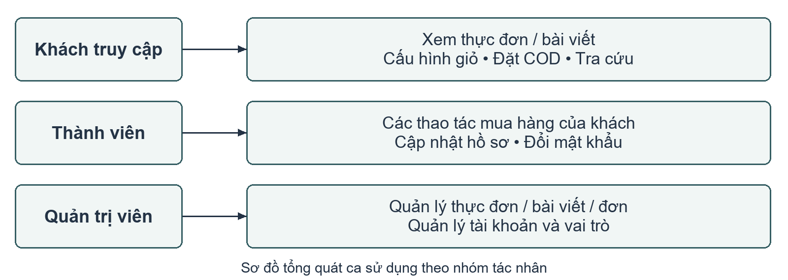
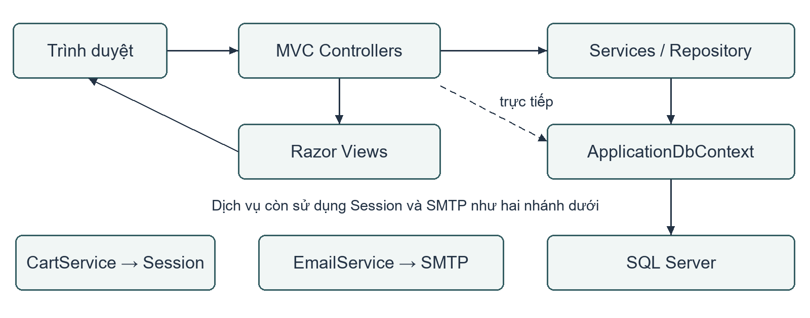
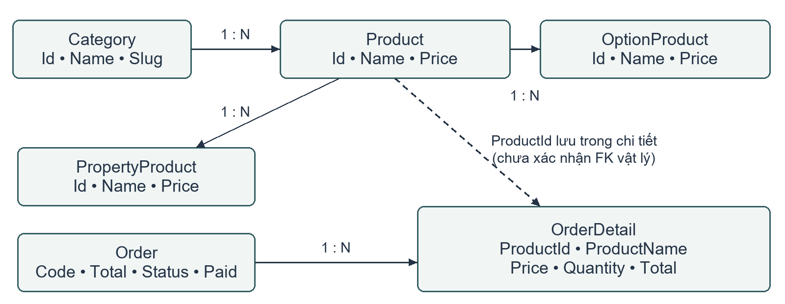
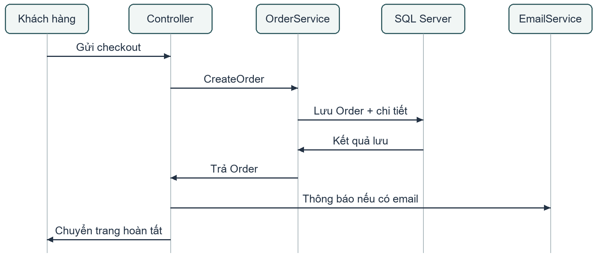

# BÁO CÁO ĐỒ ÁN MÔN HỌC

## XÂY DỰNG WEBSITE ĐẶT ĐỒ UỐNG VÀ QUẢN LÝ ĐƠN HÀNG LALACOFFEE

TRƯỜNG: [Bổ sung tên trường]

KHOA/NGÀNH: [Bổ sung]

MÔN HỌC: [Bổ sung tên môn học]

Sinh viên thực hiện: [Họ tên — Mã số sinh viên]

Lớp: [Bổ sung]

Giảng viên phụ trách: [Bổ sung]

[Địa điểm], năm 2026

<!-- pagebreak -->

## Tóm tắt

LalaCoffee là ứng dụng web phục vụ giới thiệu đồ uống, cấu hình món, quản lý giỏ hàng, đặt hàng và quản trị cửa hàng. Báo cáo trình bày bài toán, cơ sở công nghệ, phân tích yêu cầu, thiết kế dữ liệu và cách hiện thực các luồng nghiệp vụ chính. Công nghệ nền tảng gồm C#, .NET Framework 4.8, ASP.NET MVC 5, Entity Framework 6 và SQL Server; ASP.NET Identity hỗ trợ tài khoản và phân quyền, còn Unity hỗ trợ quản lý phụ thuộc.

Nội dung tập trung vào mối liên hệ giữa kiến thức và ứng dụng: MVC phân chia trách nhiệm; Session duy trì giỏ hàng; ORM hỗ trợ lưu dữ liệu; dịch vụ nghiệp vụ thống nhất phép tính và xử lý đơn; AJAX hỗ trợ trao đổi dữ liệu giao diện. Luồng đặt hàng hiện hành sử dụng COD. Thanh toán trực tuyến và biểu đồ doanh thu là hướng mở rộng.

Báo cáo được xây dựng từ mã nguồn và tài liệu dự án, kế thừa nền tảng UniCafe. Kết quả khảo sát mã được phân biệt với kết quả chạy thử. Các ca kiểm thử và danh mục ảnh minh chứng được cung cấp để người thực hiện hoàn thiện trước khi nộp.

Từ khóa: LalaCoffee; ASP.NET MVC; Entity Framework; Session; quản lý đơn hàng; COD.

## Danh mục từ viết tắt

| Ký hiệu | Diễn giải |
| --- | --- |
| MVC | Model–View–Controller — mô hình, giao diện, điều khiển |
| ORM / EF | Ánh xạ đối tượng–quan hệ / Entity Framework |
| CRUD | Tạo, đọc, cập nhật, xóa dữ liệu |
| DI | Dependency Injection — cung cấp phụ thuộc từ bên ngoài |
| AJAX / JSON | Trao đổi dữ liệu bất đồng bộ / định dạng dữ liệu văn bản |
| COD | Cash on Delivery — thanh toán khi nhận hàng |
| CSRF / SMTP | Giả mạo yêu cầu liên trang / giao thức chuyển thư điện tử |

<!-- pagebreak -->

## Mục lục

<!-- toc -->

- Chương 1. Tổng quan đề tài
- Chương 2. Cơ sở lý thuyết và công nghệ
- Chương 3. Phân tích và thiết kế hệ thống
- Chương 4. Hiện thực các chức năng
- Chương 5. Kiểm thử, đánh giá và kết luận
- Tài liệu tham khảo và phụ lục

<!-- body-start -->

# Chương 1. Tổng quan đề tài

## 1.1. Bài toán và lý do chọn đề tài

Một đồ uống có thể có nhiều cấu hình thuộc tính và tùy chọn bổ sung. Đơn vị quản lý trong giỏ vì thế gồm sản phẩm, cấu hình và số lượng. Hệ thống cần tính đủ phụ phí và duy trì sự nhất quán giữa lựa chọn, tổng tiền và dữ liệu lưu trong đơn.

LalaCoffee gồm khu vực khách hàng và quản trị. Khách duyệt món, cấu hình giỏ, đặt và tra cứu đơn; quản trị viên duy trì thực đơn và xử lý đơn. Đây là bài toán phù hợp để vận dụng kiến thức lập trình web và dữ liệu, được rút ra từ mã nguồn, không sử dụng số liệu khảo sát cửa hàng chưa thu thập.

## 1.2. Mục tiêu

Mục tiêu là phân tích website đặt đồ uống và giải thích cách công nghệ hỗ trợ nghiệp vụ: phân loại sản phẩm, cấu hình món, lưu giỏ theo phiên, tính tiền, lưu đơn cùng chi tiết, tra cứu và quản trị có phân quyền. Báo cáo làm rõ quan hệ giữa yêu cầu, thiết kế và hiện thực.

## 1.3. Phạm vi và phương pháp

Phạm vi chính gồm duyệt sản phẩm, tài khoản, giỏ hàng, đặt COD, tra cứu và quản trị. Thanh toán trực tuyến, biểu đồ doanh thu, quản lý tồn kho nguyên liệu, giao vận thời gian thực và ứng dụng di động nằm ngoài kết quả hiện hành. Trạng thái bật/tắt sản phẩm không tương đương quản lý tồn kho định lượng.

Báo cáo đối chiếu cấu hình, lớp xử lý và tài liệu để tái dựng yêu cầu, thiết kế; tách kết luận về mã khỏi kết quả chạy. Nội dung chú trọng ứng dụng kiến thức và đánh giá giải pháp [1]. Mẫu môn học được ưu tiên về hình thức.

## 1.4. Nguồn gốc và đóng góp

README ghi nhận nền tảng UniCafe [2]. Phần kế thừa, chỉnh sửa và đóng góp cá nhân cần được người thực hiện xác nhận bằng lịch sử thay đổi hoặc phân công thực tế. Phụ lục B liệt kê các mục cần hoàn thiện trước khi nộp.

<!-- pagebreak -->

# Chương 2. Cơ sở lý thuyết và công nghệ

## 2.1. C#, .NET Framework và ASP.NET MVC

C# là ngôn ngữ dùng để viết lớp và luồng điều khiển; .NET Framework 4.8 cung cấp môi trường thực thi và thư viện nền tảng; ASP.NET MVC 5 tổ chức việc tiếp nhận yêu cầu và tạo phản hồi web. Ba thành phần có vai trò khác nhau: biểu đạt chương trình, thực thi chương trình và hỗ trợ xây dựng ứng dụng web. Phiên bản được đối chiếu với csproj và packages.config [3].

MVC chia trách nhiệm thành Model, View và Controller. Model biểu diễn dữ liệu và khái niệm nghiệp vụ; View trình bày thông tin; Controller tiếp nhận yêu cầu và điều phối xử lý. Một action có thể trả giao diện, dữ liệu hoặc chuyển hướng tùy mục đích yêu cầu [4].

Trong LalaCoffee, Product và Order là model; OrderController tiếp nhận đặt hàng; tệp cshtml dựng giao diện. OrderService và OrderCalculator đảm nhiệm một phần xử lý bên ngoài controller. Khi chỉnh hiển thị, người phát triển sửa View; khi chỉnh công thức, sửa bộ tính tiền; khi chỉnh lưu đơn, sửa dịch vụ. Controller vẫn còn thao tác Context trực tiếp nên mức phân tách chưa đồng đều.

## 2.2. Razor, ViewModel và xử lý biểu mẫu

Razor kết hợp HTML với biểu thức C# trong tệp cshtml. Máy chủ xử lý View để tạo HTML gửi đến trình duyệt. Ví dụ, chương trình lặp qua danh sách món để tạo thẻ sản phẩm hoặc hiển thị lỗi theo dữ liệu controller cung cấp. Vai trò dựng giao diện của View được trình bày tại [5]; cú pháp Razor được đối chiếu với tệp cshtml của dự án.

ViewModel mang dữ liệu phục vụ một màn hình hoặc thao tác. CheckOutViewModel tập hợp tên, email, điện thoại, địa chỉ và ghi chú. Cách này mô tả đầu vào rõ hơn đọc từng khóa từ FormCollection. ViewModel vẫn cần kiểm tra giá trị và quyền tại máy chủ.

Vòng xử lý gồm nhận yêu cầu, gán dữ liệu, kiểm tra ModelState và nghiệp vụ, gọi dịch vụ rồi trả lỗi hoặc chuyển trang. Máy chủ phải quyết định tính hợp lệ vì người dùng có thể sửa yêu cầu HTTP, kể cả các giá trị xuất phát từ biểu mẫu.

<!-- pagebreak -->

## 2.3. SQL Server, dữ liệu quan hệ và Entity Framework

Cơ sở dữ liệu quan hệ tổ chức dữ liệu thành bảng, hàng và cột. Khóa chính nhận diện bản ghi; khóa ngoại biểu diễn liên hệ giữa bảng khi được khai báo. Tách danh mục, sản phẩm, đơn và chi tiết đơn giúp dữ liệu có cấu trúc rõ ràng. Một đơn có nhiều dòng hàng nhưng chỉ cần một bản ghi người nhận.

SQL Server là hệ quản trị cơ sở dữ liệu được dự án cấu hình sử dụng. Entity Framework 6 là ORM, hỗ trợ ánh xạ đối tượng với dữ liệu và thao tác qua DbContext [6]. Trong ứng dụng, Products phục vụ truy vấn thực đơn; Orders và OrderDetails nhận dữ liệu giao dịch.

ApplicationDbContext kế thừa IdentityDbContext và khai báo DbSet nghiệp vụ. EF hỗ trợ theo dõi thay đổi và ghi dữ liệu khi gọi SaveChanges. LINQ biểu đạt các thao tác lọc, sắp xếp và chọn dữ liệu bằng C#. Lợi ích là chương trình sử dụng đối tượng nhất quán với model; tuy nhiên, ORM không tự kiểm tra mọi quy tắc nghiệp vụ như tùy chọn có thuộc đúng sản phẩm hay không.

Mô hình lớp cần đối chiếu schema triển khai: tên UserId không chứng minh có khóa ngoại; lưu thành công một lần không chứng minh có chống gửi lặp. Các tính chất này cần kiểm tra bằng cấu hình và dữ liệu thực tế.

## 2.4. HTTP, Session và vòng đời giỏ hàng

HTTP xử lý các yêu cầu độc lập. Session duy trì dữ liệu gắn với phiên truy cập qua nhiều yêu cầu trong một khoảng thời gian [7]. Khách có thể thêm món ở trang chi tiết rồi chuyển sang trang giỏ mà vẫn giữ lựa chọn.

CartService lưu danh sách CartItem dưới khóa Session là Cart. Khi đặt hàng, dữ liệu tạm được chuyển thành Order và OrderDetail trong cơ sở dữ liệu. Giỏ phục vụ quá trình lựa chọn, còn đơn lưu lịch sử giao dịch. Phân biệt này giải thích vì sao xóa giỏ sau đặt hàng không được làm mất thông tin đơn đã lưu.

Giỏ theo Session không tự đồng bộ giữa nhiều thiết bị. Muốn lưu giỏ lâu dài theo tài khoản cần cơ chế lưu và khôi phục riêng; khi thử nghiệm cần xét hết phiên và đổi trình duyệt.

<!-- pagebreak -->

## 2.5. Identity, OWIN và bảo vệ biểu mẫu

Xác thực trả lời người truy cập là ai; phân quyền xác định người đó được làm gì. ASP.NET Identity hỗ trợ quản lý tài khoản và vai trò; OWIN kết nối các thành phần xử lý yêu cầu, trong đó dự án dùng cookie xác thực [8].

Hồ sơ gắn với danh tính đăng nhập; khu vực quản trị yêu cầu Admin. Ẩn nút không thay thế kiểm tra quyền tại controller: người dùng vẫn có thể gửi yêu cầu trực tiếp. Kiểm thử phải quan sát phản hồi và dữ liệu sau thao tác.

CSRF là tình huống trang ngoài lợi dụng phiên xác thực để tạo yêu cầu ngoài ý muốn. Token chống giả mạo cùng ValidateAntiForgeryToken hỗ trợ bảo vệ biểu mẫu MVC [9]. Token không xác nhận số lượng món hoặc địa chỉ là hợp lệ; kiểm tra dữ liệu và kiểm tra quyền vẫn cần thực hiện riêng.

## 2.6. Dịch vụ, Repository và Dependency Injection

Dịch vụ nghiệp vụ tập hợp công việc như quản lý giỏ, tính tiền hoặc tạo đơn; Repository đóng gói một số thao tác dữ liệu. Dependency Injection cung cấp đối tượng phụ thuộc từ bên ngoài thay vì để mỗi lớp tự tạo chúng. Unity đăng ký các interface như ICartService, IOrderService và IRepository với lớp hiện thực [3].

Controller có thể làm việc qua hợp đồng dịch vụ, phép tính được dùng chung và cấu hình vòng đời được tập trung. Một số lớp còn tự tạo phụ thuộc và truy cập Context nên đây là MVC nguyên khối có tách dịch vụ một phần.

## 2.7. Bootstrap, jQuery, AJAX, JSON và SMTP

Bootstrap cung cấp lớp bố cục và thành phần giao diện [10]. jQuery hỗ trợ tương tác DOM và gửi AJAX; AJAX trao đổi dữ liệu mà không nhất thiết tải lại cả trang [11]. JSON là định dạng văn bản cho dữ liệu có cấu trúc. DataTables dùng yêu cầu tìm kiếm, sắp xếp và phân trang để lấy phần dữ liệu cần hiển thị từ máy chủ [12].

SMTP phục vụ chuyển thư điện tử. EmailService gửi mã và đường dẫn tra cứu; kết quả gửi thư khác kết quả lưu đơn. Phiên bản gói khai báo là MVC 5.2.7, EF 6.4.4, Unity 5.11.10, jQuery 3.6.4 và Bootstrap 3.4.1. Chúng phản ánh cấu hình phụ thuộc, chưa xác nhận tài nguyên được nạp tại mọi màn hình.

<!-- pagebreak -->

# Chương 3. Phân tích và thiết kế hệ thống

## 3.1. Tác nhân và yêu cầu chức năng

Khách xem thực đơn, tạo giỏ, đặt và tra cứu đơn. Thành viên dùng thêm hồ sơ và đổi mật khẩu. Quản trị viên có vai trò Admin để duy trì dữ liệu cửa hàng; SMTP là hệ thống ngoài phục vụ thông báo.

Sơ đồ gom thao tác theo mục tiêu; thành viên có thể mua hàng như khách. Đăng nhập không phải điều kiện bắt buộc cho mọi đơn hàng. Phụ lục A truy vết các chức năng tới mã nguồn.

## 3.2. Yêu cầu phi chức năng

Các mục tiêu cần nghiệm thu gồm: dữ liệu đơn nhất quán với giỏ; thao tác quản trị yêu cầu đúng quyền; thông báo lỗi đủ rõ; giao diện sử dụng được trên máy tính và điện thoại; dữ liệu cấu hình nhạy cảm không xuất hiện trong báo cáo; hệ thống có khả năng bảo trì theo các thành phần. Đây là tiêu chí đánh giá đề xuất. Chưa có phép đo hoặc kiểm toán để kết luận mọi tiêu chí đã đạt.

<!-- pagebreak -->

## 3.3. Kiến trúc ứng dụng

Ứng dụng nguyên khối dùng controller điều phối, Razor dựng HTML, CartService lưu Session và DbContext truy cập SQL Server. Sơ đồ có nhánh controller truy cập dữ liệu trực tiếp để phản ánh mã hiện hữu. Tách phép tính và tạo chi tiết đơn thành dịch vụ giúp giảm phạm vi sửa, nhưng phụ thuộc dữ liệu còn phân tán.

## 3.4. Ca sử dụng đặt hàng COD

UC01 — Đặt hàng COD. Khách hàng gửi thông tin nhận hợp lệ với giỏ có hàng. Khi thành công, đơn và chi tiết được lưu, trạng thái Chờ xác nhận, chưa thanh toán; giỏ được xóa và trang hoàn tất xuất hiện.

Luồng chính: đọc giỏ; kiểm tra biểu mẫu và điện thoại; ép Payment = cash; tạo mã, tính và lưu đơn; lưu thông tin hoàn tất vào Session; cập nhật trạng thái; xóa giỏ; gọi email nếu có địa chỉ; chuyển trang. Dữ liệu sai trả lại biểu mẫu và lỗi. Giỏ rỗng, gửi lặp, lỗi dữ liệu và SMTP là các ngoại lệ ưu tiên.

SaveChanges trong tạo đơn không bao phủ toàn bộ luồng HTTP. Nếu có lỗi sau khi lưu, việc trả trang lỗi không có nghĩa đơn đã được hoàn tác; cần đối chiếu dữ liệu khi kiểm thử.

<!-- pagebreak -->

## 3.5. Mô hình dữ liệu logic

Category phân nhóm Product; sản phẩm có thuộc tính và tùy chọn. Order lưu giao dịch, OrderDetail lưu dòng hàng. Nhãn 1–N chỉ quan hệ logic; nét đứt Product–OrderDetail biểu diễn ProductId được lưu, chưa xác nhận khóa ngoại vật lý. UserId và ParentId cũng cần đối chiếu schema.

## 3.6. Lựa chọn thiết kế dữ liệu

OrderService lưu tên, giá, số lượng và tổng dòng; thuộc tính/tùy chọn chuyển thành chuỗi mô tả. Bản chụp giữ thông tin giao dịch khi thực đơn thay đổi, nhưng khó thống kê từng topping hơn mô hình chuẩn hóa.

Dòng giỏ phân biệt bằng sản phẩm, thuộc tính và danh sách tùy chọn. So sánh tùy chọn hiện xét thứ tự nên cùng tập nhưng khác thứ tự có thể không gộp; cần quyết định nghiệp vụ trước khi chuẩn hóa.

Giá trị dòng bằng tổng giá cơ bản, giá thuộc tính và các giá tùy chọn, nhân số lượng. Trạng thái xử lý đơn và trạng thái thanh toán là hai trường riêng biệt. Hoàn tất đơn không tự động đồng nghĩa với đã thanh toán nếu không có cập nhật tương ứng.

Các nhãn chuẩn là Chờ xác nhận, Đang chuẩn bị, Đang giao, Hoàn tất và Đã hủy. OrderStatus chuẩn hóa chuỗi nhưng chưa áp đặt đầy đủ quy tắc chuyển trạng thái.

<!-- pagebreak -->

# Chương 4. Hiện thực các chức năng

## 4.1. Duyệt thực đơn và chi tiết

HomeController cung cấp trang chủ, bộ sưu tập theo danh mục và thực đơn, cùng các trang thông tin. ProductController nạp dữ liệu sản phẩm, thuộc tính và tùy chọn; Details truy xuất theo slug và tìm sản phẩm liên quan. Khi không xác định được sản phẩm, luồng có chuyển hướng về danh sách. Cấu trúc này cho phép khách hàng tiếp cận dữ liệu từ danh mục rồi chuyển sang cấu hình từng món.

## 4.2. Quản lý giỏ theo cấu hình

CartService sử dụng khóa Session là Cart. Khi thêm một dòng trùng cấu hình theo cách so sánh hiện tại, dịch vụ cộng số lượng; nếu chưa tồn tại thì thêm dòng mới. Xóa dòng dựa vào Guid định danh CartItem. Giỏ không được mô tả là đồng bộ giữa nhiều thiết bị hoặc lưu lâu dài theo tài khoản vì cơ chế được khảo sát là Session.

OrderCalculator dùng chung công thức cho giỏ và đơn. Dữ liệu ID không tồn tại, lựa chọn thuộc sản phẩm khác và số lượng bất thường vẫn cần kiểm tra riêng trước khi tính/lưu.

## 4.3. Công thức tính tiền

Với dòng i, ký hiệu bᵢ là giá sản phẩm, sᵢ là giá thuộc tính, oᵢⱼ là giá tùy chọn thứ j và qᵢ là số lượng. Đơn giá cấu hình uᵢ = bᵢ + sᵢ + Σoᵢⱼ; thành tiền tᵢ = uᵢ × qᵢ; tổng đơn T = Σtᵢ. OrderCalculator trả 0 cho thành tiền khi số lượng không dương; CartController.AddToCart có nhánh từ chối số lượng không hợp lệ.

Ví dụ minh họa tự xây dựng, không phải dữ liệu bán hàng: giá cơ bản 30.000 đồng, thuộc tính 5.000 đồng, hai tùy chọn 7.000 và 3.000 đồng, số lượng 2. Đơn giá cấu hình là 45.000 đồng và thành tiền là 90.000 đồng. Một dòng thứ hai giá 25.000 đồng, không phụ phí, số lượng 1 tạo tổng đơn 115.000 đồng. Công thức được dùng để thiết lập giá trị kỳ vọng khi kiểm thử, không được ghi là kết quả đo.

Các model khảo sát dùng decimal cho tiền. Kiểm thử cần đối chiếu từng dòng và cấu hình, tránh chỉ kiểm tra tổng khiến hai sai lệch có thể bù trừ nhau.

<!-- pagebreak -->

## 4.4. Tiếp nhận và lưu đơn COD

Hình 4.1 là nhánh thành công sau kiểm tra dữ liệu. OrderService tạo OrderDetail từ giỏ và dùng OrderCalculator để tính tổng; controller cập nhật trạng thái và xóa giỏ trước khi thông báo. Nhánh lỗi cần đối chiếu thời điểm lưu, không chỉ nhìn trang phản hồi.

Mã đơn gồm 12 chữ cái in hoa/chữ số, sinh bằng Random có khóa đồng bộ. Cần ràng buộc duy nhất và xử lý va chạm để bảo đảm mã không trùng trên toàn bộ cơ sở dữ liệu.

## 4.5. Tra cứu và thông báo

CheckOut ép Payment = cash; MomoPay chuyển trang chủ. Mã xử lý thanh toán còn lưu chưa tạo thành chức năng trực tuyến hoàn chỉnh.

Đơn mới Chờ xác nhận, Paid = 0. SearchOrder trả đơn và chi tiết theo mã; quyền xem dữ liệu người nhận cần đánh giá nếu mã bị chia sẻ.

EmailService gửi mã và đường dẫn tra cứu, có thể bỏ qua khi thiếu thông tin/cấu hình; lỗi được bắt và ghi Trace. Do đó, lưu đơn và nhận email là hai kết quả riêng.

Checkout gọi SendOrderConfirmation đồng bộ. Có phương thức Async không đồng nghĩa đang gửi nền; thời gian chờ SMTP có thể ảnh hưởng phản hồi.

<!-- pagebreak -->

## 4.6. Tài khoản, hồ sơ và quản trị thực đơn

AccountController hỗ trợ đăng ký, đăng nhập, hồ sơ và đổi mật khẩu. Hồ sơ lấy từ danh tính hiện tại, kiểm tra dữ liệu và trùng email/điện thoại; đổi mật khẩu gọi UserManager và làm mới cookie khi thành công.

Quản trị cung cấp thao tác với thực đơn và bài viết. Tạo sản phẩm kiểm tra tên, slug, mô tả, giá tối thiểu 1.000 đồng, danh mục và slug trùng; lỗi được trả theo trường cùng dữ liệu đã nhập.

Bật/tắt sản phẩm quản lý trạng thái kinh doanh, không phải kiểm kê nguyên liệu. Hiệu lực lọc trên mọi trang cần thử bằng dữ liệu thực tế.

## 4.7. Quản trị đơn và phân quyền

ManageOrderController.GetData tìm kiếm, sắp xếp và phân trang tại máy chủ qua Count, OrderBy, Skip, Take. JSON gồm draw, recordsTotal, recordsFiltered, data theo hợp đồng DataTables [12]. Cách này giảm dữ liệu trả mỗi trang; lợi ích độ trễ cần đo thực tế.

Quản trị viên xem chi tiết, sửa người nhận, ghi chú, phương thức, Status và Paid. Chuẩn hóa nhãn chưa áp đặt đầy đủ quy tắc chuyển trạng thái. Trang Stats hiện chuyển quản lý đơn, chưa có dashboard doanh thu.

ManageRoleController ngăn gỡ Admin cuối và yêu cầu xác nhận khi tự gỡ. Hiệu lực trên phiên đăng nhập và yêu cầu đồng thời cần chạy thử; nhóm người dùng còn có danh sách và thao tác mật khẩu.

## 4.8. Minh họa và giới hạn xử lý

Ảnh ứng dụng đang chờ bổ sung theo Phụ lục B. Cần kèm dữ liệu, thao tác và nhận xét; sơ đồ mã nguồn không thay thế ảnh chạy thật.

Nhiều action có ValidateAntiForgeryToken; AddToCart không khai báo trực tiếp nên cần xem bộ lọc chung và thử HTTP. Một số lỗi trả ex.Message ra giao diện, cần thông báo phù hợp trước khi triển khai công khai.

<!-- pagebreak -->

# Chương 5. Kiểm thử, đánh giá và kết luận

## 5.1. Phương pháp và phạm vi kiểm tra

Lần biên soạn đã đối chiếu cấu hình và mã các luồng chính; chưa build, chạy ứng dụng, cơ sở dữ liệu hoặc email thật. Bảng dưới là kế hoạch, toàn bộ Chưa chạy. Khi chạy cần ghi bản nguồn, môi trường, đầu vào, kết quả và bằng chứng.

Kiểm thử đặt hàng đối chiếu Order, OrderDetail và giỏ; kiểm thử quyền gửi yêu cầu trực tiếp tới máy chủ. Xác định tiêu chí đạt trước khi quan sát.

## 5.2. Các ca kiểm thử trọng tâm

| Mã | Thao tác/dữ liệu | Kết quả kỳ vọng | Thực tế |
| --- | --- | --- | --- |
| T01 | Mở danh mục và chi tiết | Đúng món và cấu hình | Chưa chạy |
| T02 | Dòng minh họa ở mục 4.3 | Thành tiền 90.000 đồng | Chưa chạy |
| T03 | Thêm cùng/khác cấu hình | Gộp/tách dòng phù hợp | Chưa chạy |
| T04 | Số lượng 0/-1; ID sai/khác sản phẩm | Từ chối có kiểm soát | Chưa chạy |
| T05 | Giỏ rỗng; thông tin nhận sai | Hiện lỗi, không lưu đơn | Chưa chạy |
| T06 | COD hợp lệ; gửi Payment khác cash | Lưu COD, tổng đúng, Chờ xác nhận, chưa thanh toán | Chưa chạy |
| T07 | Gửi lặp; SMTP lỗi/thiếu cấu hình | Ghi nhận đơn trùng/lỗi, đối chiếu dữ liệu đã lưu | Chưa chạy |
| T08 | Khách vào Admin; sửa đơn thiếu token | Bị chặn theo quyền/bộ lọc | Chưa chạy |

T07 khảo sát hành vi, chưa xác nhận chống gửi lặp. Ca bổ sung: cập nhật/xóa giỏ; tra cứu mã đúng/sai/rỗng; tìm/sắp xếp/phân trang đơn; slug trùng, giá 999; gỡ Admin cuối; đảo topping; hồ sơ trùng; mật khẩu cũ sai. Ghi theo mẫu Phụ lục B.

<!-- pagebreak -->

## 5.3. Đánh giá giải pháp

OrderCalculator tạo điểm đối chiếu phép tính chung. OrderService tách lưu chi tiết khỏi biểu mẫu và lưu bản chụp tên/giá; Status và Paid phân biệt tiến trình xử lý với thu tiền, phù hợp COD.

Hạn chế gồm truy cập dữ liệu phân tán, email đồng bộ, mã đơn cần bảo đảm duy nhất, trạng thái chưa có quy tắc chuyển đầy đủ và lựa chọn lưu dạng chuỗi khó phân tích. So sánh topping theo vị trí cũng có thể khác cách hiểu nghiệp vụ theo tập hợp.

Chưa có bằng chứng về hiệu năng dưới tải, tính toàn vẹn khi gửi đồng thời và an toàn vận hành. Cơ sở dữ liệu triển khai có thể khác model; cần chạy kế hoạch kiểm thử trước khi kết luận nghiệm thu.

## 5.4. Kết luận

LalaCoffee có mã cho duyệt món, cấu hình giỏ, COD, tra cứu và quản trị. Báo cáo giải thích MVC, ORM, Session, quyền, dịch vụ và AJAX trong các luồng cụ thể; sơ đồ và ví dụ tính tiền kết nối kiến thức với thiết kế.

Kết quả học tập là hiểu cách yêu cầu đi qua giao diện, controller, dịch vụ và dữ liệu, cùng giới hạn từng lựa chọn. Đóng góp cá nhân và minh chứng chạy thật cần người thực hiện xác nhận.

## 5.5. Hướng phát triển

Ưu tiên kiểm tra cấu hình giỏ, quyền dữ liệu và chống giả mạo; tiếp theo là chống gửi đơn lặp, mã duy nhất và chuyển trạng thái. Mỗi thay đổi cần kiểm chứng ở HTTP và cơ sở dữ liệu.

Về kiến trúc, thống nhất nghiệp vụ trong dịch vụ, giảm FormCollection, dùng ViewModel rõ ràng. Nếu tách email khỏi yêu cầu, cần cơ chế thực thi và theo dõi đáng tin cậy.

Thống kê doanh thu và thanh toán trực tuyến cần phạm vi riêng: định nghĩa số liệu, điều kiện ghi nhận, xác minh giao dịch và kiểm thử tích hợp. Chỉ mở rộng tồn kho/giao vận khi có yêu cầu và nguồn lực.

<!-- body-end -->

<!-- pagebreak -->

# Tài liệu tham khảo

[1] Trường Đại học Khoa học Tự nhiên, ĐHQG-HCM. Hướng dẫn các vấn đề liên quan về báo cáo đồ án tốt nghiệp. https://www.ctda.hcmus.edu.vn/wp-content/uploads/2022/03/2019-Huong-dan-do-an-tot-nghiep.pdf. Truy cập 07/11/2026. Tham khảo định hướng nội dung; không thay thế mẫu môn học.

[2] Repository LalaCoffee. README.md; .scratch/lala-coffee-transformation/spec.md. https://github.com/longkunz/lala-coffee-shop. Nguồn lịch sử và yêu cầu, cần đối chiếu mã hiện hành.

[3] LalaCoffee. LalaCoffee.csproj; packages.config; App_Start/UnityConfig.cs. Bản nguồn cục bộ khảo sát 07/11/2026.

[4] Microsoft Learn. Getting started with ASP.NET MVC 5. https://learn.microsoft.com/en-us/aspnet/mvc/overview/getting-started/introduction/getting-started. Truy cập 07/11/2026.

[5] Microsoft Learn. ASP.NET MVC Views Overview (C#). https://learn.microsoft.com/en-us/aspnet/mvc/overview/older-versions-1/views/asp-net-mvc-views-overview-cs. Truy cập 07/11/2026. Tham khảo vai trò View; Razor đối chiếu tệp cshtml của dự án.

[6] Microsoft Learn. Working with DbContext — EF6. https://learn.microsoft.com/en-us/ef/ef6/fundamentals/working-with-dbcontext. Truy cập 07/11/2026.

[7] Microsoft Learn. ASP.NET Session State Overview. https://learn.microsoft.com/en-us/previous-versions/aspnet/ms178581(v=vs.100). Truy cập 07/11/2026.

[8] Microsoft Learn. Introduction to ASP.NET Identity. https://learn.microsoft.com/en-us/aspnet/identity/overview/getting-started/introduction-to-aspnet-identity. Truy cập 07/11/2026.

[9] Microsoft Learn. XSRF/CSRF Prevention in ASP.NET MVC and Web Pages. https://learn.microsoft.com/en-us/aspnet/mvc/overview/security/xsrfcsrf-prevention-in-aspnet-mvc-and-web-pages. Truy cập 07/11/2026.

[10] Bootstrap. CSS — Bootstrap 3.4. https://getbootstrap.com/docs/3.4/css/. Truy cập 07/11/2026.

[11] jQuery. jQuery.ajax(). https://api.jquery.com/jQuery.ajax/. Truy cập 07/11/2026.

[12] DataTables. Server-side processing. https://datatables.net/manual/server-side. Truy cập 07/11/2026.

<!-- pagebreak -->

# Phụ lục A. Truy vết và phạm vi khảo sát

Các đường dẫn dưới đây tương đối với thư mục LalaCoffee. Thiết kế được tái dựng từ mã nguồn, không phải bằng chứng về quá trình thiết kế ban đầu của sinh viên. Commit nền là eac4dd53e0d720d8477dd96e7ce1a730514887b0; workspace có thay đổi chưa commit nên không đồng nhất toàn bộ nội dung với commit này.

| Mã | Chức năng có trong mã nguồn | Điểm hiện thực chính |
| --- | --- | --- |
| F01 | Trang chủ, danh mục và thực đơn | Controllers/HomeController.cs |
| F02 | Danh sách, chi tiết và sản phẩm liên quan | Controllers/ProductController.cs |
| F03 | Đọc nội dung bài viết | Controllers/BlogController.cs |
| F04 | Đăng ký, đăng nhập, đăng xuất | Controllers/AccountController.cs |
| F05 | Cập nhật hồ sơ, đổi mật khẩu | AccountController.UserProfile, ChangePassword |
| F06 | Thêm, cập nhật, xóa dòng giỏ | Controllers/CartController.cs; Services/CartService.cs |
| F07 | Đặt hàng COD và lưu chi tiết | OrderController.CheckOut; OrderService.CreateOrder |
| F08 | Tra cứu theo mã đơn | OrderController.SearchOrder |
| F09 | Gửi thông báo đơn có điều kiện cấu hình | Services/Email/EmailService.cs |
| F10 | Quản lý sản phẩm, danh mục | Admin/ManageProductController; ManageCategoryController |
| F11 | Quản lý thuộc tính và tùy chọn | Admin/ManagePropertyProductController; ManageOptionProductController |
| F12 | Danh sách, chi tiết, cập nhật, xóa đơn | Admin/ManageOrderController |
| F13 | Quản lý bài viết | Admin/ManageBlogController |
| F14 | Danh sách tài khoản, đổi/đặt lại mật khẩu | Admin/ManageUserController |
| F15 | Tạo, xóa, gán và gỡ vai trò | Admin/ManageRoleController |

Các tên bắt đầu bằng Admin trong bảng là viết gọn cho Areas/Admin/Controllers. Bảng xác nhận có hiện thực, không thay thế biên bản nghiệm thu. Không suy rộng F14 thành đầy đủ CRUD tài khoản vì các action được khảo sát tập trung vào danh sách và mật khẩu.

Các model được đối chiếu tại Models/Product.cs, Category.cs, OrderDetail.cs và Data/ApplicationDbContext.cs. Các điểm lệch tài liệu gồm README ghi Framework 4.7.2 nhưng csproj là 4.8; checkout dùng COD; MomoPay chuyển trang chủ; Stats/Index.cshtml chuyển quản lý đơn; checkout gọi email đồng bộ. Bootstrap 3.4.1 là phiên bản gói khai báo, không dùng yêu cầu nâng cấp trong spec để xác nhận đã triển khai.

Khảo sát kết hợp đồ thị mã với đọc nguồn khi độ phủ hoặc độ mới của chỉ mục chưa đủ. Báo cáo không dùng trạng thái ticket làm bằng chứng chương trình chạy đúng.

<!-- pagebreak -->

# Phụ lục B. Bổ sung bằng chứng trước khi nộp

## B.1. Môi trường và biên bản kiểm thử

Chuẩn bị Visual Studio có công cụ ASP.NET, .NET Framework 4.8 Developer Pack, gói phụ thuộc và SQL Server thử nghiệm. Cấu hình DefaultConnection; đọc hướng dẫn triển khai trong repository trước khi áp dụng script. Không đưa mật khẩu, khóa dịch vụ hay thông tin cá nhân thật vào minh chứng công khai. Chạy qua IIS Express và ghi rõ phiên bản hoặc lỗi nếu có.

Mẫu biên bản: mã ca — bản nguồn — ngày giờ — môi trường — đầu vào — kỳ vọng — thực tế — đạt/không đạt — bằng chứng — người thực hiện. Với đặt hàng, đối chiếu Order và OrderDetail. Các mục này đang chờ chạy thật, không phải kết quả đã nghiệm thu.

## B.2. Ảnh giao diện cần bổ sung

| Ảnh dự kiến | Nội dung và chú thích |
| --- | --- |
| B.1. Cấu hình món | Tên, giá gốc, thuộc tính và topping; giải thích lựa chọn |
| B.2. Giỏ và checkout | Hai cấu hình, số lượng, tổng tiền và thông tin COD |
| B.3. Hoàn tất và tra cứu | Mã đơn thử, chi tiết và trạng thái khớp dữ liệu lưu |
| B.4. Quản trị đơn | Tìm kiếm/phân trang và cập nhật trạng thái |

Ảnh phải từ đúng bản chạy, có ngày, kịch bản và nhận xét. Có thể giữ ảnh tại phụ lục để bảo toàn dung lượng nội dung. Các sơ đồ vẽ từ mã nguồn không thay thế ảnh ứng dụng.

## B.3. Đóng góp và hình thức bản nộp

Người thực hiện xác nhận phần kế thừa UniCafe, phần chỉnh sửa LalaCoffee và phần việc cá nhân bằng lịch sử thay đổi hoặc phân công thực tế. Chỉ nhận đóng góp đã tham gia; bổ sung lời cảm ơn/cam đoan nếu mẫu môn yêu cầu. Không tự điền chữ ký, điểm hoặc nhận xét của giảng viên.

Trước khi nộp: điền bìa, đối chiếu mẫu môn, hoàn thiện kiểm thử, chèn ảnh, cập nhật mục lục và rà soát trích dẫn. Bản xuất dùng A4, Times New Roman 13, giãn dòng 1,5; các mốc ngắt trang phục vụ mục tiêu khoảng 12 trang phần thân. Kiểm tra lại số trang khi thay đổi nội dung/định dạng. Nếu trường yêu cầu khai báo công cụ hỗ trợ biên soạn, thực hiện theo quy định đó.
